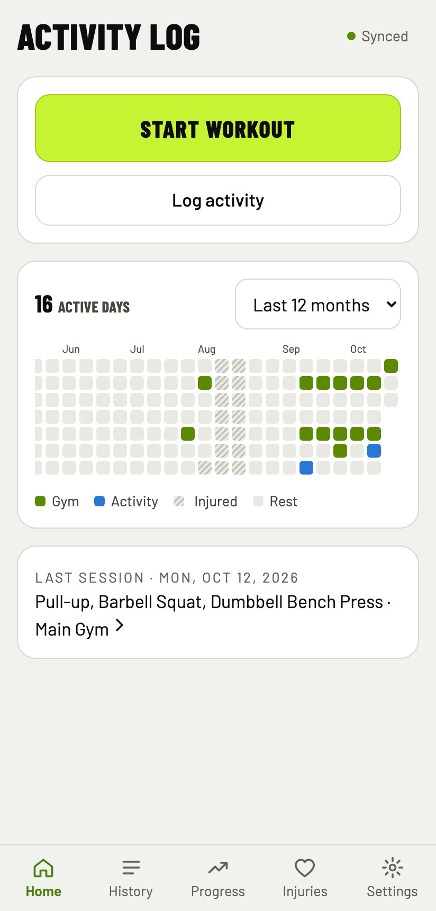
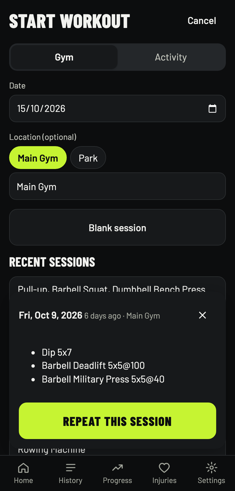
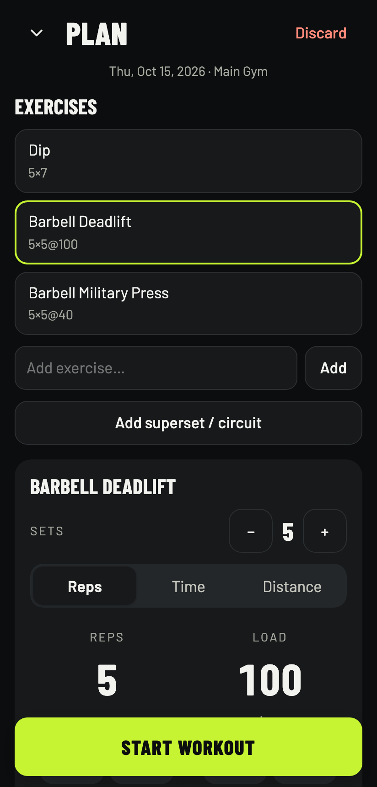
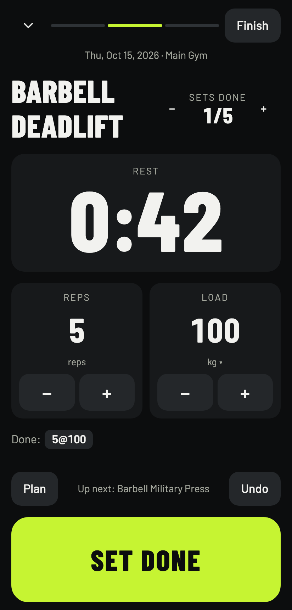
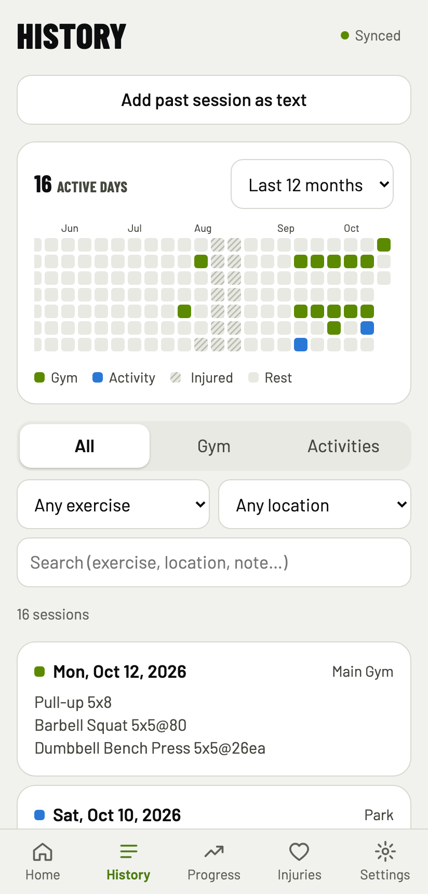
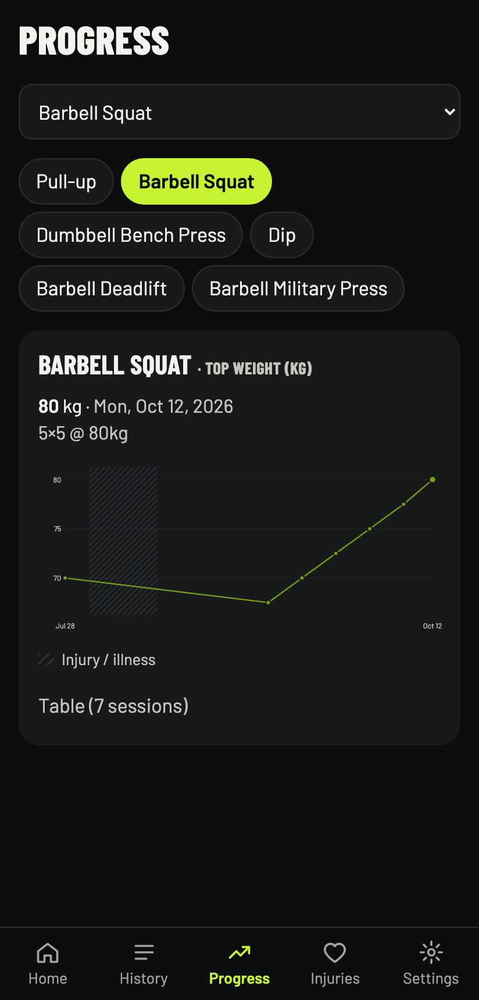

# Activity Log

Installable web app (PWA) for logging gym sessions and other activities. The data is one markdown file, `log.md`, in a private GitHub repo. You can also edit it by hand.

<table>
  <tr>
    <td></td>
    <td></td>
    <td></td>
  </tr>
  <tr>
    <td></td>
    <td></td>
    <td></td>
  </tr>
</table>

Screenshots use mock data (`app/mock/seed.md`).

- `app/`: the PWA (Vite + React + TypeScript).
- `auth/`: a Cloudflare Worker that exchanges GitHub App OAuth codes. It holds the client secret.

## How it works

- Data lives in `log.md` in a private repo, read and written through the GitHub Contents API. Sessions are drafted on the device (they survive reloads and no signal) and committed on Finish. Offline saves queue and retry; conflicts with edits made elsewhere are merged by replaying the change on the latest file.
- Sign-in is a GitHub App installed only on the data repo with `Contents: read & write`, so tokens can't touch any other repo. Authorization code + PKCE; access tokens last 8h and refresh silently (refresh tokens last 6 months and rotate).
- The client secret lives only in the Worker's secrets. The client ID is public by design. The app loads no third-party scripts and ships a strict CSP.

## File format (`log.md`)

```
# Injuries
- 2026-06-02..2026-07-09 Sprained ankle
- 2026-10-01.. Knee pain              <- ongoing

# Log

## 2026-10-13 · Downtown
- Pull-up 4x9
- Barbell Squat 5x5@65
- Dumbbell Bench Press 5x5@25ea
- Farmer Carry Hold 4x60s@30ea

## 2026-09-07 · Uptown
- Pull-up 8,8,8,7,6
- Pull-up 5x5@+10
- Rowing Machine 1000m 3:50
- Superset x4
  - Pull-up 4
  - Dip 4
Back felt off

## 2026-09-14
Football with friends
```

- `## YYYY-MM-DD[ · Location]` starts a session, newest first. The same date can repeat.
- `- ` lines are exercises; plain lines are notes (or the whole entry, for activities).
- Sets: `5x5`, per-set `8,8,7`, time `4x60s` / `3x1:30`, distance `1000m 3:50`.
- Weight: `@65` total kg, `@25ea` per hand, `@+10` added to bodyweight, per-set `@60,65,70`.
- Groups: `- Superset x4` (or `Circuit x3`, …) with nested exercises.
- Trailing `(note)` on an exercise. Nothing is ever dropped: lines the app can't parse are kept as text and shown as warnings.

## Try it locally (mock mode)

No GitHub and no Cloudflare. A fake "GitHub" lives in the browser's localStorage.

```sh
cd app
npm install
npm run dev:mock
```

- On the Mac: http://localhost:5173/activity-log/
- On your Android phone, same Wi-Fi: the `Network:` URL Vite prints, e.g. `http://192.168.x.x:5173/activity-log/`

Seed data comes from `app/mock/log.local.md` when that file exists (gitignored, for your real history). Otherwise it uses `app/mock/seed.md`. Settings → **Mock mode** lets you simulate being offline and reset the data.

On the phone over plain http, screen wake-lock and install-to-home-screen are off (they need https). Everything else works.

## Develop

```sh
cd app
npm test          # unit tests (vitest)
npm run e2e       # end-to-end (playwright, mocked GitHub)
npm run typecheck && npm run lint && npm run format:check
```

After cloning, enable the pre-commit privacy check: `git config core.hooksPath .githooks`. It runs `scripts/check-public.mjs`, which CI also runs.

## Deploy

Live at https://gmadorell.github.io/activity-log/. Install it on Android with Chrome → ⋮ → **Add to Home screen**.

- **App:** every push to `main` runs CI; when CI passes, `deploy.yml` builds and publishes to GitHub Pages. Build config comes from repo *variables* (all public by design): `GH_APP_CLIENT_ID`, `GH_APP_SLUG`, `AUTH_URL`, `DATA_REPO`. Deploy skips itself while `AUTH_URL` is unset.
- **Worker:** `cd auth && npx wrangler deploy` (not automated). The client secret is set only with `npx wrangler secret put GITHUB_CLIENT_SECRET`. `ALLOWED_ORIGINS` in `wrangler.toml` limits which sites may call it.
- **GitHub App:** callback `https://gmadorell.github.io/activity-log/`, "Expire user authorization tokens" on, webhook off, `Contents: read & write`, installed only on the data repo. Its private keys are unused.

Setting it up from scratch: create the private data repo with a `log.md`, create the GitHub App as above, deploy the Worker and put the secret, set the four repo variables, then enable Pages with "GitHub Actions" as the source.
